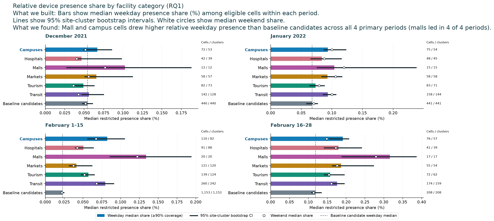
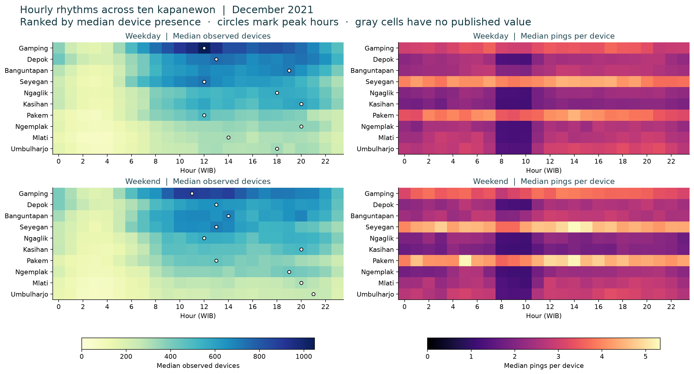

# City Magnets: What Draws the Crowds in Yogyakarta?

**Course:** Data Engineering / Human Mobility Group Project — Universitas Gadjah Mada (UGM)  
**Lecturer:** Dr. Widyawan (`widyawan@ugm.ac.id`)  
**Full Project Specification:** [`project_brief_city_magnets_yogyakarta_refined.md`](project_brief_city_magnets_yogyakarta_refined.md)

---

## Demo, documentation, and Colab

- [Open the live interactive 500 m Yogyakarta spatial map (GitHub Pages)](https://altafparves.github.io/Human-Mobility/)
- [Watch the five-minute City Magnets demo](https://youtu.be/YwWwRleElAA)
- [Project brief and methodology](project_brief_city_magnets_yogyakarta_refined.md)
- [Project documentation and handoffs](docs/) · [Visualization and demo handoff](docs/HANDOFF_TO_AKHNAF.md)
- [Find out how we process the data here (Colab preview)](https://colab.research.google.com/github/altafparves/Human-Mobility/blob/main/notebooks/visuals.ipynb) — opens the current visualization walkthrough while the dedicated data-processing notebook is being prepared.

---

## 1. Project Overview

Using anonymized mobile device presence data (**JogjaPulse**) and **OpenStreetMap (OSM)** spatial features, this project investigates how observed mobile device activity across the Special Region of Yogyakarta (DIY) differs between $500\text{ m} \times 500\text{ m}$ grid cells containing **university campuses, hospitals, shopping malls, traditional markets, tourism sites, and transit stops**, and how those activity rhythms shift across weekdays, weekends, and the Christmas & New Year (*Nataru*) holiday period.

### Core Research Questions
1. **Facility Pull (RQ1):** Which mapped facility categories are associated with higher relative device presence after accounting for geography, mixed land uses, and publication coverage?
2. **Weekly Rhythm (RQ2):** How does the weekday-to-weekend presence ratio differ by facility category (**H1: Education**, **H2: Commercial & Tourism**, **H3: Healthcare**)?
3. **Holiday Shockwave (RQ3):** How does the Christmas & New Year period (24 Dec 2021 – 2 Jan 2022) coincide with changes in relative device presence, and which apparent shifts remain credible after accounting for the **1 January 2022 sample discontinuity**?
4. **Diurnal Pulse (RQ4):** At what hours of the day ($0\text{–}23\text{ WIB}$) do the busiest *kapanewon* (sub-districts) peak in device presence (`n_maids`) and ping intensity (`n_pings / n_maids`)?

---

## 2. Data Sources

| Dataset | Granularity | Description | Source / Access |
| :--- | :--- | :--- | :--- |
| **JogjaPulse — Daily Grid** | $500\text{ m} \times 500\text{ m}$ cell $\times$ Day | Daily distinct mobile device counts (`n_maids`) across 5,715 cells (Dec 2021 – Apr 2022). | [Zenodo Record 23157460](https://zenodo.org/records/23157460) |
| **JogjaPulse — Hourly Sub-District** | *Kapanewon* $\times$ Hour | Hourly device counts (`n_maids`) and ping volume (`n_pings`) across 78 *kapanewon*. | [Zenodo Record 23157460](https://zenodo.org/records/23157460) |
| **OpenStreetMap (OSM)** | Point Nodes & Polygons (`way`/`relation`) | Real-world locations and footprints of urban facilities across DIY (`amenity`, `shop`, `tourism`, `healthcare`, `highway`, `railway`). | [Overpass API](https://overpass-turbo.eu/) / [Geofabrik Java](https://download.geofabrik.de/asia/indonesia/java.html) |

---

## 3. Data Engineering Architecture (Medallion Pipeline)

```text
[JogjaPulse CSVs] ──┐
                    ├──> (1. Bronze / Raw) ──> (2. Silver / Clean & Spatial) ──> (3. Gold / Metrics) ──> [Visuals & Interactive Map]
[OSM Overpass API] ─┘
```

1. **Bronze Layer (`data/raw/`):**
   * Immutable raw CSVs from JogjaPulse and GeoJSON/JSON extracts from the Overpass API (historical snapshot targeting `2021-12-01T00:00:00Z` + current validation extract).
2. **Silver Layer (`data/silver/`):**
   * **Temporal Cleaning:** Standardized `WIB (UTC+7)` timestamps, anomalous date flagging (`2022-03-08`), sampling period segmentation, and publication coverage filtering ($\ge 90\%$ primary threshold; $80\%$ and $95\%$ sensitivity checks).
   * **Geospatial Engineering:** Reconstructed $500\text{ m} \times 500\text{ m}$ grid polygons in `EPSG:32749` (UTM Zone 49S), deduplicated OSM facilities (merging overlapping point nodes and campus/building polygons), and spatial joins (`gpd.sjoin`) classifying single-category, mixed-use, and matched baseline cells.
3. **Gold Layer (`data/gold/`):**
   * Analytical Parquet tables containing daily **Published Presence Share (%)**, within-period **Weekday-to-Weekend Ratios**, matched-weekday **Nataru Event Comparisons**, cluster-robust uncertainty intervals, and hourly *kapanewon* diurnal profiles.

---

## 4. Repository Structure (Data Engineering Best Practice)

```text
Human-Mobility/
├── configs/
│   └── osm_tags.yaml                  # Pipeline parameters, CRS, date windows & OSM tag taxonomy
├── data/
│   ├── raw/                           # Bronze Layer: Immutable JogjaPulse CSVs & raw OSM GeoJSON (git-ignored)
│   ├── silver/                        # Silver Layer: Cleaned Parquet tables & deduplicated spatial joins (git-ignored)
│   └── gold/                          # Gold Layer: Final aggregated cell metrics & hourly summaries (git-ignored)
├── src/
│   ├── __init__.py
│   ├── ingest.py                      # Role 1: Zenodo verification & Overpass API extraction
│   ├── clean_temporal.py              # Role 1: Calendar grid, coverage audit & temporal cleaning
│   ├── spatial_join.py                # Role 2: EPSG:32749 grid reconstruction, OSM deduplication & spatial join
│   ├── metrics.py                     # Role 3: Presence share, weekday/weekend ratios & statistical tests
│   └── visualize.py                   # Role 4: Interactive Folium/Kepler map & static chart generators
├── docs/                              # Role handoff documents (HANDOFF_ROLE1.md .. HANDOFF_ROLE4.md)
├── notebooks/                         # Role playgrounds, visuals.ipynb & standalone Colab notebooks
├── figures/                           # Exported static charts (.png) & interactive map (city_magnets_map.html)
├── tests/                             # Data quality & pipeline unit tests (Roles 1–4, 40 contract tests)
├── project_brief_city_magnets_yogyakarta_refined.md   # Full methodological & technical project brief
├── requirements.txt                   # Python dependencies
└── README.md                          # Project documentation
```

---

## 5. Team Members, Role Selection & Execution Order (4 Members)

**Team Members (4 People):**
* **Altaf**
* **Akhnaf**
* **Nalen**
* **Rafi Busthami**

Each member chooses **one dedicated technical role** below, while **Storytelling, Slide Deck Design, the 5-Minute eLOK Video, and Repository Documentation** are shared equally by all 4 members.

### A. Technical Pipeline Roles (Open for Selection)

> 📌 **Role 1 status: ✅ Complete.** See the handoff document [`docs/HANDOFF_ROLE1.md`](docs/HANDOFF_ROLE1.md) for what was built, how to use it, and next steps for Role 2 (Nalen), Role 3, and Role 4.
>
> 📌 **Role 2 status: ✅ Complete.** See [`docs/HANDOFF_ROLE2.md`](docs/HANDOFF_ROLE2.md) for the deduplication rules, the `grid_facilities.parquet` column guide for Role 3 (Rafi), and map notes for Role 4. Visual walkthrough: [`notebooks/role2_playground.ipynb`](notebooks/role2_playground.ipynb).
>
> 📌 **Role 3 status: ✅ Complete.** See [`docs/HANDOFF_ROLE3.md`](docs/HANDOFF_ROLE3.md) for the eight Gold tables, the cost of each statistical decision, and what Role 4 (Akhnaf) should plot — including the four things that would undo the statistics. Headline rules: every ratio stays inside one sampling period, intervals resample Role 2's site clusters, and no single holiday-uplift value is produced because the Nataru window crosses the 1 January sample break.
>
> 📌 **Role 4 status: ✅ Complete.** See [`docs/HANDOFF_ROLE4.md`](docs/HANDOFF_ROLE4.md) for the interactive 500 m Leaflet/Folium map ([`figures/city_magnets_map.html`](figures/city_magnets_map.html)), the four static figures covering RQ1–RQ4 (`facility_pull.png`, `weekday_weekend_ratio.png`, `nataru_timeseries.png`, `kapanewon_diurnal_heatmap.png`), executed walkthrough and standalone Colab notebooks in `notebooks/`, and presentation talking points.

| Role | PIC (Choose Role) | Pipeline Stage | Execution Order & Priority Flag | Key Responsibilities & Deliverables |
| :--- | :--- | :--- | :--- | :--- |
| **Role 1: Data Ingestion & Temporal Cleaning Lead** | *Altaf* | Bronze $\rightarrow$ Silver (Temporal) | ⚡ **START FIRST (Phase 1 Blocker)**<br>🛡️ **Data Quality Foundation** | • Build `src/ingest.py` to load JogjaPulse CSVs and query OSM Overpass API (`node`/`way`/`relation`).<br>• Conduct Week 1 DIY landmark audit (UGM, UNY, Amplaz, Pakuwon, Sardjito, Malioboro).<br>• Build `src/clean_temporal.py` to standardize `UTC+7` timestamps, flag `2022-03-08`, compute weekday/weekend publication coverage per cell, and apply the $\ge 90\%$ coverage rule. |
| **Role 2: Geospatial Engineering & Facility Deduplication Lead** | *Nalen* | Silver $\rightarrow$ Gold (Spatial) | ⚡ **START FIRST (Phase 1 Blocker)**<br>🔥 **MOST TECHNICALLY DIFFICULT** | • Build `src/spatial_join.py` to reconstruct $500\text{ m} \times 500\text{ m}$ polygons in `EPSG:32749`.<br>• Map OSM tags (`configs/osm_tags.yaml`) into the 6 core facility categories.<br>• Deduplicate overlapping OSM features (point nodes vs. polygons/multi-cell campuses) and run `gpd.sjoin` to classify single-category, mixed-use, and matched baseline cells. |
| **Role 3: Mobility Analytics & Statistical Modeling Lead** | *Rafi Busthami* | Gold (Analytical Metrics) | ⏳ **Phase 2**<br>⭐ **MOST IMPORTANT / CRITICAL FOR RESEARCH VALIDITY** | • Build `src/metrics.py` to compute daily **Published Presence Share (%)** across declared and common-support cells.<br>• Compute cell-level **Weekday-to-Weekend Ratios** (H1–H3) and matched-weekday **Nataru Holiday Comparisons** (explicitly isolating the Jan 1 sample break).<br>• Run cluster-robust resampling/uncertainty intervals, sensitivity checks ($80\%/90\%/95\%$), and hourly *kapanewon* aggregations. |
| **Role 4: Geospatial Visualization & Interactive Map Lead** | *Akhnaf* | Serve & Visual Analytics | ⏳ **Phase 3**<br>🎯 **HIGH-IMPACT VISUAL DELIVERABLE** | • Build `src/visualize.py` & `notebooks/visuals.ipynb` with a unified visual theme.<br>• Create the **Interactive 500m Spatial Map** (Folium/Kepler.gl), **Weekday/Weekend Ratio Bar Chart**, **Nataru Time-Series with Coverage Panel**, and **24-Hour Kapanewon Diurnal Heatmap** in `figures/`. |

---

### B. Who Should Work First? (Execution Order & Criticality Guide)

```text
PHASE 1 (Week 1 - Parallel Upstream Blockers)
├── Role 1 (Ingestion & Temporal Cleaning) ──┐
└── Role 2 (Geospatial & OSM Deduplication) ─┴──> Unlocks Silver Layer (data/silver/)
                                                        │
PHASE 2 (Week 2 - Core Statistical Engine)              ▼
└── Role 3 (Mobility Metrics & Statistical Modeling) ──> Unlocks Gold Layer (data/gold/)
                                                        │
PHASE 3 (Week 2–3 - Serve & Visual Storytelling)        ▼
└── Role 4 (Interactive Map & Core Figures) ───────────> Final Charts + Shared 5-Min Video
```

1. ⚡ **Who Must Work First (Phase 1 — Immediate Parallel Start): Role 1 & Role 2**
   * **Role 1** and **Role 2** are the upstream blockers and must start in **Week 1 in parallel**.
   * While **Role 1** cleans the temporal coverage calendar and extracts OSM data, **Role 2** reconstructs the $500\text{ m} \times 500\text{ m}$ `EPSG:32749` grid polygons and builds the OSM facility deduplication logic.
   * *Parallel preparation for Roles 3 & 4 in Week 1:* While waiting for `data/silver/`, Role 3 writes modular DuckDB/Pandas metric functions on a sample subset, and Role 4 prepares the Folium/Kepler map and chart templates.
2. 🔥 **Most Technically Difficult Part: Role 2 (Geospatial Engineering & Facility Deduplication)**
   * OpenStreetMap represents large complexes (such as **UGM** or **RSUP Dr. Sardjito**) as both boundary polygons (`ways`/`relations`) spanning multiple $500\text{ m}$ cells and dozens of internal point `nodes` (faculties, clinics, ATMs).
   * Merging and deduplicating these in `EPSG:32749` so a single campus isn't counted 50 times—while separating **single-category cells**, **mixed-use cells**, and **spatially matched baseline cells**—is the most complex engineering challenge in the pipeline.
3. ⭐ **Most Important / Critical Part for Grading: Role 3 (Mobility Analytics & Statistical Modeling)** *(supported by Role 1's coverage filter)*
   * The JogjaPulse dataset contains two major statistical pitfalls highlighted in the dataset documentation:
     * **1 January 2022 & 16 February 2022 Sample Discontinuities:** Sharp drops/jumps in total observed devices (`n_maids`) caused by upstream panel changes, not just real-world holiday movement. Role 3 must normalize all comparisons using **Published Presence Share (%)** across a consistent set of well-covered cells and explicitly isolate the Jan 1 break.
     * **$k=5$ Privacy Suppression (64.6% `NaN` rows):** Cells with $<5$ devices are suppressed. Role 3 (using Role 1's coverage flags) must enforce the $\ge 90\%$ weekday/weekend coverage rule and run sensitivity checks ($80\%, 90\%, 95\%$) plus cluster-robust confidence intervals so our conclusions for **H1, H2, and H3** are scientifically valid.

---

### C. Shared Team Responsibilities (All 4 Members)
* **GitHub Documentation & Code Review:** Collaboratively maintain `README.md`, review Pull Requests, and verify end-to-end reproducibility.
* **Storytelling & Methodological Rigor:** Synthesize results for RQ1–RQ4 and clearly communicate dataset limitations ($k=5$ privacy suppression, Jan 1 & Feb 16 sample breaks, mixed-use $500\text{ m}$ cells, and association vs. causation).
* **5-Minute Video Presentation (eLOK UGM — Before Week 13):** Co-write the script, record presenter segments, and edit the final 5-minute video.
* **Live Class Presentation (Weeks 13–14):** Co-design the presentation deck and present together in class.

---

## 6. Quickstart & Setup

### 1. Clone the Repository & Create Environment
```bash
git clone https://github.com/altafparves/Human-Mobility.git
cd Human-Mobility
python3 -m venv .venv
source .venv/bin/activate
pip install -r requirements.txt
```

### 2. Place Raw JogjaPulse Data
Download `presence_cell500m_daily.csv` and `presence_kapanewon_hourly.csv` from [Zenodo (Record 23157460)](https://zenodo.org/records/23157460) and place them inside `data/raw/`.

### 3. Run the Medallion Pipeline
```bash
# Step 1: Ingest OSM features & verify raw files (Bronze)
python -m src.ingest

# Step 2: Clean temporal coverage & standardize dates (Silver - Temporal)
python -m src.clean_temporal

# Step 3: Reconstruct 500m UTM grid, deduplicate OSM POIs & spatial join (Silver - Spatial)
python -m src.spatial_join

# Step 4: Compute Gold mobility metrics & statistical intervals (Gold)
python -m src.metrics

# Step 5: Generate static figures & interactive HTML map (Serve)
python -m src.visualize
```

---

## 7. Key Findings & Visual Deliverables (RQ1–RQ4)

All visual outputs below are generated deterministically from the merged Silver and Gold layers via `python -m src.visualize` and verified by **40 automated contract tests** (`python -m pytest -q tests/`).

| Research Question / Hypothesis | Headline Finding (Verified Gold Metrics) | Primary Deliverable |
| :--- | :--- | :--- |
| **Spatial Coverage & Map Context** | Out of **5,715** grid cells ($500\text{ m} \times 500\text{ m}$), **700** (Dec 2021), **705** (Jan 2022), **1,628** (Feb 1–15), and **407** (Feb 16–28) pass the $\ge 90\%$ ordinary weekday *and* weekend coverage bar. In Feb 1–15, **829 cells** lean weekday ($\ge 1.05$), **498** lean weekend ($< 0.95$), and **301** sit near parity ($0.95\text{–}<1.05$). | [`figures/city_magnets_map.html`](figures/city_magnets_map.html) |
| **RQ1: Facility Pull** | Facility-associated cells draw higher median weekday presence shares than unmapped baseline candidate cells across all 4 primary periods. **Malls** ($0.103\%\text{–}0.316\%$) and **Campuses** ($0.067\%\text{–}0.191\%$) lead every period against baseline candidates ($0.023\%\text{–}0.119\%$). Observational 1:1 matching confirms positive differences for campuses while disclosing residual activity imbalance ($\text{SMD up to } 0.57$). | [`figures/facility_pull.png`](figures/facility_pull.png)<br>[`notebooks/facility_pull.ipynb`](notebooks/facility_pull.ipynb) |
| **RQ2: Weekly Rhythm (`H1–H3`)** | • **H1 (Education — Campuses):** **Supported in 4/4 primary periods** and robust across single-category diamonds ($\diamond$) and $80\%/90\%/95\%$ coverage rules (median weekday/weekend ratio **$1.291$** in Dec 2021, **$1.152$** in Feb 1–15, **$1.138$** in Feb 16–28; compressing to **$1.022$** during the Jan 2022 academic break).<br>• **H2 (Commercial, Markets & Tourism):** Analyzed separately, showing distinct regimes — shifting weekend-leaning in Jan 2022 (**Malls $0.893$**, **Tourism $0.964$**, **Markets $0.969$**), with single-category markets sitting much closer to parity ($0.98\text{–}1.04$) than mixed-use cells.<br>• **H3 (Healthcare — Hospitals):** Weekday-leaning ($1.012\text{–}1.290$) due to outpatient schedules and urban co-location, sitting below campuses in February. | [`figures/weekday_weekend_ratio.png`](figures/weekday_weekend_ratio.png)<br>[`notebooks/weekday_weekend_ratio.ipynb`](notebooks/weekday_weekend_ratio.ipynb) |
| **RQ3: Holiday Shockwave (*Nataru*)** | Compared against matched non-event weekdays in Dec 2021, **Tourism** cells rose **$+29\%$ ($1.29$)** on Christmas Day (`2021-12-25`) before dipping **$-36\%$ ($0.64$)** on `2021-12-29` and recovering on New Year's Eve. **1 January 2022** is an upstream panel discontinuity (coverage drops from $27.5\%$ to $23.9\%$) and is explicitly withheld so a panel step change is never misread as holiday travel. | [`figures/nataru_timeseries.png`](figures/nataru_timeseries.png)<br>[`notebooks/nataru_timeseries.ipynb`](notebooks/nataru_timeseries.ipynb) |
| **RQ4: Diurnal Pulse (*Kapanewon*)** | Across the 10 busiest *kapanewon* ($0\text{–}23\text{ WIB}$), urban/campus hubs peak around midday on weekdays (**Gamping** $12\text{:00} \rightarrow 11\text{:00 WIB}$ on weekends; **Depok** $13\text{:00 WIB}$), whereas commuter rings peak in the evening on weekdays and shift earlier on weekends (**Banguntapan** $19\text{:00} \rightarrow 14\text{:00 WIB}$; **Kasihan** $20\text{:00 WIB}$). Ping intensity (`n_pings / n_maids`) diagnoses app reporting behavior rather than crowd size. | [`figures/kapanewon_diurnal_heatmap.png`](figures/kapanewon_diurnal_heatmap.png)<br>[`notebooks/kapanewon_diurnal_heatmap.ipynb`](notebooks/kapanewon_diurnal_heatmap.ipynb) |

### Visual Gallery

| RQ1: Facility Pull | RQ2: Weekly Rhythm (H1–H3) |
| :---: | :---: |
|  |  |
| **RQ3: Nataru Holiday Window (with Coverage Panel)** | **RQ4: 24-Hour Kapanewon Diurnal Heatmap** |
|  |  |

### Interactive 500 m Map & Standalone Google Colab Notebooks

Open the live map directly in your browser at **[https://altafparves.github.io/Human-Mobility/](https://altafparves.github.io/Human-Mobility/)**, or download [`figures/city_magnets_map.html`](figures/city_magnets_map.html) using GitHub's raw download for offline use. The HTML embeds the 500 m grid, Leaflet runtime, DIY regency boundaries (`districts.geojson`), DIY major roads (`roads.geojson`), deduplicated OSM facility footprints, and all 9 audited DIY landmarks, so it works **100% offline** (with an optional toggleable online street basemap). The default view opens on **February 1–15, 2022**.

- Choose a sampling period in the layer control, or use **Color by** to switch between the weekday/weekend ratio, weekday publication coverage, and weekend publication coverage.
- Click any $500\text{ m}$ square to compare its weekday and weekend shares and inspect its coverage in the side panel.
- Read the valid-cell count above the map before interpreting colors. See [`docs/HANDOFF_ROLE4.md`](docs/HANDOFF_ROLE4.md) and [`notebooks/visuals.ipynb`](notebooks/visuals.ipynb) for full details.

Each figure also has a self-contained Google Colab notebook (`notebooks/*.ipynb`) with embedded Gold/Silver summary tables (**Runtime → Run all**):

| Notebook | Figure |
| :--- | :--- |
| [`notebooks/facility_pull.ipynb`](notebooks/facility_pull.ipynb) | [`figures/facility_pull.png`](figures/facility_pull.png) |
| [`notebooks/weekday_weekend_ratio.ipynb`](notebooks/weekday_weekend_ratio.ipynb) | [`figures/weekday_weekend_ratio.png`](figures/weekday_weekend_ratio.png) |
| [`notebooks/nataru_timeseries.ipynb`](notebooks/nataru_timeseries.ipynb) | [`figures/nataru_timeseries.png`](figures/nataru_timeseries.png) |
| [`notebooks/kapanewon_diurnal_heatmap.ipynb`](notebooks/kapanewon_diurnal_heatmap.ipynb) | [`figures/kapanewon_diurnal_heatmap.png`](figures/kapanewon_diurnal_heatmap.png) |

---

## 8. License & Attribution
* **Mobility Data:** JogjaPulse dataset via Zenodo ([Record 23157460](https://zenodo.org/records/23157460)).
* **Spatial Facility & Road Data:** © [OpenStreetMap](https://www.openstreetmap.org/copyright) contributors, available under the Open Database License (ODbL).
* **Administrative Boundaries:** [geoBoundaries Indonesia ADM2](https://www.geoboundaries.org/api/current/gbOpen/IDN/ADM2/) (CC BY 3.0 IGO — Statistics Indonesia / BPS, WFP, OCHA ROAP).
