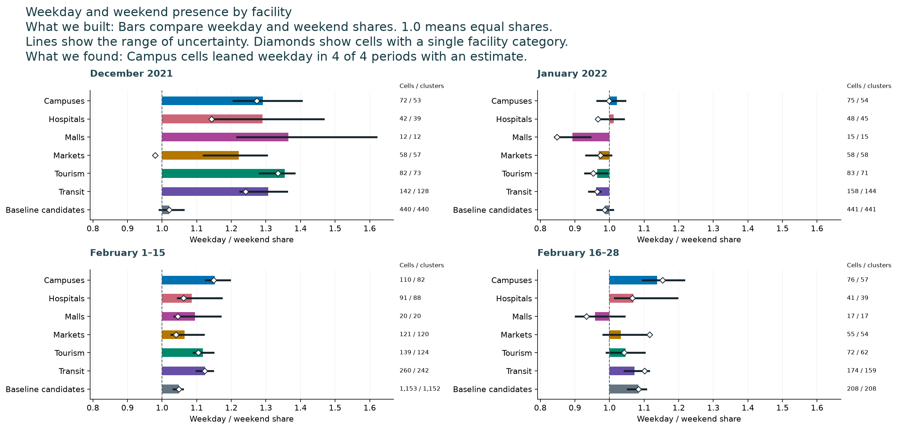
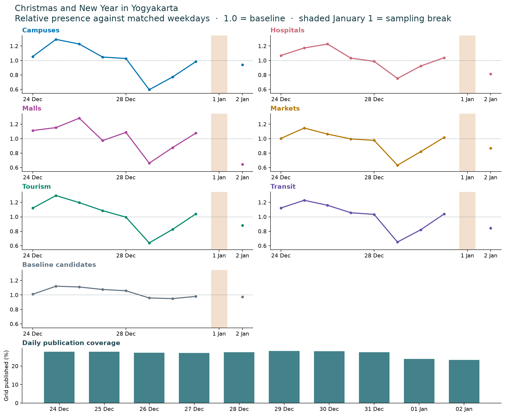

# City Magnets: What Draws the Crowds in Yogyakarta?

**Data Engineering / Human Mobility Project** - Universitas Gadjah Mada (UGM)  
**Lecturer:** Dr. Widyawan (`widyawan@ugm.ac.id`)  
**Team:** Akhnaf, Altaf, Nalen, Rafi Busthami

| | |
| :--- | :--- |
| **Interactive 500 m Map** (GitHub Pages) | https://altafparves.github.io/Human-Mobility/ · [`figures/city_magnets_map.html`](figures/city_magnets_map.html) (offline HTML) |
| **Demo video** (5-min presentation) | https://youtu.be/YwWwRleElAA |
| **Colab walkthrough** (Pipeline & visuals) | [Open the team walkthrough in Colab](https://colab.research.google.com/github/altafparves/Human-Mobility/blob/main/notebooks/city_magnets_team_walkthrough.ipynb) |
| **Standalone figure Colabs** (RQ1–RQ4) | [`facility_pull`](https://colab.research.google.com/github/altafparves/Human-Mobility/blob/main/notebooks/facility_pull.ipynb) · [`weekday_weekend_ratio`](https://colab.research.google.com/github/altafparves/Human-Mobility/blob/main/notebooks/weekday_weekend_ratio.ipynb) · [`nataru_timeseries`](https://colab.research.google.com/github/altafparves/Human-Mobility/blob/main/notebooks/nataru_timeseries.ipynb) · [`kapanewon_diurnal_heatmap`](https://colab.research.google.com/github/altafparves/Human-Mobility/blob/main/notebooks/kapanewon_diurnal_heatmap.ipynb) |
| **Documentation** | [`project_brief_city_magnets_yogyakarta_refined.md`](project_brief_city_magnets_yogyakarta_refined.md) · [`docs/`](docs/) ([Stage 1](docs/HANDOFF_ROLE1.md) · [Stage 2](docs/HANDOFF_ROLE2.md) · [Stage 3](docs/HANDOFF_ROLE3.md) · [Stage 4](docs/HANDOFF_ROLE4.md)) |
| **Dataset** (JogjaPulse on Zenodo) | https://zenodo.org/records/23157460 |

---

## 1. Project Overview

Using anonymized mobile device presence data (**JogjaPulse**) and **OpenStreetMap (OSM)** spatial features, this project investigates how observed mobile device activity across the Special Region of Yogyakarta (DIY) differs between $500\text{ m} \times 500\text{ m}$ grid cells containing **university campuses, hospitals, shopping malls, traditional markets, tourism sites, and transit stops**, and how those activity rhythms shift across weekdays, weekends, and the Christmas & New Year (*Nataru*) holiday period.

### Core Research Questions
1. **Facility Pull (RQ1):** Which mapped facility categories are associated with higher relative device presence after accounting for geography, mixed land uses, and publication coverage?
2. **Weekly Rhythm (RQ2):** How does the weekday-to-weekend presence ratio differ by facility category (**H1: Education**, **H2: Commercial & Tourism**, **H3: Healthcare**)?
3. **Holiday Shockwave (RQ3):** How does the Christmas & New Year period (24 Dec 2021 – 2 Jan 2022) coincide with changes in relative device presence, and which apparent shifts remain credible after accounting for the **1 January 2022 sample discontinuity**?
4. **Diurnal Pulse (RQ4):** At what hours of the day ($0\text{–}23\text{ WIB}$) do the busiest *kapanewon* (sub-districts) peak in device presence (`n_maids`) and ping intensity (`n_pings / n_maids`)?

---

## 2. Key Findings & Visual Gallery

All visual outputs are generated deterministically from the Silver and Gold layers via `python -m src.visualize` and verified by **40 automated contract tests** (`python -m pytest -q tests/`).

| RQ1: Facility Pull | RQ2: Weekly Rhythm (H1–H3) |
| :---: | :---: |
|  |  |
| **RQ3: Nataru Holiday Window (with Coverage Panel)** | **RQ4: 24-Hour Kapanewon Diurnal Heatmap** |
|  |  |

### Summary of Findings

| Research Question | Headline Finding | Deliverable |
| :--- | :--- | :--- |
| **Spatial Coverage & Map Context** | Out of **5,715** grid cells ($500\text{ m} \times 500\text{ m}$), **700** (Dec 2021), **705** (Jan 2022), **1,628** (Feb 1–15), and **407** (Feb 16–28) pass the $\ge 90\%$ weekday and weekend coverage bar. In Feb 1–15, **829 cells** lean weekday ($\ge 1.05$), **498** lean weekend ($< 0.95$), and **301** sit near parity ($0.95\text{–}1.05$). | [`figures/city_magnets_map.html`](figures/city_magnets_map.html) |
| **RQ1: Facility Pull** | Facility-associated cells draw higher median weekday presence shares than unmapped baseline candidate cells across all 4 periods. **Malls** ($0.103\%\text{–}0.316\%$) and **Campuses** ($0.067\%\text{–}0.191\%$) lead every period against baseline candidates ($0.023\%\text{–}0.119\%$). | [`figures/facility_pull.png`](figures/facility_pull.png) |
| **RQ2: Weekly Rhythm (`H1–H3`)** | • **H1 (Campuses):** Supported in 4/4 primary periods (median weekday/weekend ratio **$1.291$** in Dec 2021, **$1.152$** in Feb 1–15, **$1.138$** in Feb 16–28; compressing to **$1.022$** during the Jan 2022 break).<br>• **H2 (Commercial, Markets & Tourism):** Shift weekend-leaning in Jan 2022 (**Malls $0.893$**, **Tourism $0.964$**, **Markets $0.969$**), with single-category markets near parity ($0.98\text{–}1.04$).<br>• **H3 (Hospitals):** Weekday-leaning ($1.012\text{–}1.290$) due to outpatient schedules and urban co-location. | [`figures/weekday_weekend_ratio.png`](figures/weekday_weekend_ratio.png) |
| **RQ3: Holiday Shockwave (*Nataru*)** | Compared against matched non-event weekdays in Dec 2021, **Tourism** cells rose **$+29\%$ ($1.29$)** on Christmas Day (`2021-12-25`) before dipping **$-36\%$ ($0.64$)** on `2021-12-29` and recovering on New Year's Eve. **1 January 2022** is an upstream panel discontinuity (coverage drops from $27.5\%$ to $23.9\%$) and is explicitly isolated from holiday travel claims. | [`figures/nataru_timeseries.png`](figures/nataru_timeseries.png) |
| **RQ4: Diurnal Pulse (*Kapanewon*)** | Across the 10 busiest *kapanewon* ($0\text{–}23\text{ WIB}$), urban/campus hubs peak around midday on weekdays (**Gamping** $12\text{:00 WIB}$, **Depok** $13\text{:00 WIB}$), whereas commuter rings peak in the evening on weekdays and shift earlier on weekends (**Banguntapan** $19\text{:00} \rightarrow 14\text{:00 WIB}$, **Kasihan** $20\text{:00 WIB}$). | [`figures/kapanewon_diurnal_heatmap.png`](figures/kapanewon_diurnal_heatmap.png) |

> **Interactive 500 m Map:** Open the live map at [altafparves.github.io/Human-Mobility](https://altafparves.github.io/Human-Mobility/) (or download [`figures/city_magnets_map.html`](figures/city_magnets_map.html) for 100% offline use). Use the layer control to switch sampling periods or color by weekday/weekend ratio vs. publication coverage, and click any $500\text{ m}$ cell to inspect its metrics and deduplicated OSM facilities.

---

## 3. Architecture & Data Sources

### Data Sources

| Dataset | Granularity | Description | Source |
| :--- | :--- | :--- | :--- |
| **JogjaPulse — Daily Grid** | $500\text{ m} \times 500\text{ m}$ cell $\times$ Day | Daily distinct mobile device counts (`n_maids`) across 5,715 cells (Dec 2021 – Apr 2022; $k=5$ privacy threshold). | [Zenodo 23157460](https://zenodo.org/records/23157460) |
| **JogjaPulse — Hourly Sub-District** | *Kapanewon* $\times$ Hour | Hourly device counts (`n_maids`) and ping volume (`n_pings`) across 78 *kapanewon*. | [Zenodo 23157460](https://zenodo.org/records/23157460) |
| **OpenStreetMap (OSM)** | Nodes, Ways & Relations | Footprints and locations of urban facilities across DIY (`amenity`, `shop`, `tourism`, `healthcare`, `highway`, `railway`). | [Overpass API](https://overpass-turbo.eu/) |

### Medallion Pipeline

```text
[JogjaPulse CSVs] ──┐
                    ├──> (1. Bronze / Raw) ──> (2. Silver / Clean & Spatial) ──> (3. Gold / Metrics) ──> [Visuals & Interactive Map]
[OSM Overpass API] ─┘
```

1. **Bronze Layer (`data/raw/`):** Immutable JogjaPulse CSVs and Overpass API GeoJSON extracts (historical snapshot targeting `2021-12-01T00:00:00Z` + validation extract).
2. **Silver Layer (`data/silver/`):** Standardized `WIB (UTC+7)` calendar grid, anomalous date flagging (`2022-03-08`), sampling period segmentation, $\ge 90\%$ publication coverage filtering, `EPSG:32749` (UTM Zone 49S) $500\text{ m}$ grid reconstruction, and deduplicated OSM spatial joins classifying single-category, mixed-use, and baseline cells.
3. **Gold Layer (`data/gold/`):** Analytical Parquet tables containing daily **Published Presence Share (%)**, within-period **Weekday-to-Weekend Ratios**, matched-weekday **Nataru Event Comparisons**, cluster-robust uncertainty intervals, and hourly *kapanewon* diurnal profiles.

---

## 4. Quickstart & Reproducibility

### 1. Clone & Install Dependencies
```bash
git clone https://github.com/altafparves/Human-Mobility.git
cd Human-Mobility
python3 -m venv .venv
source .venv/bin/activate
pip install -r requirements.txt
```

### 2. Place Raw JogjaPulse Data
Download `presence_cell500m_daily.csv` and `presence_kapanewon_hourly.csv` from [Zenodo (Record 23157460)](https://zenodo.org/records/23157460) and place them inside `data/raw/`.

### 3. Run the Pipeline & Tests
```bash
python -m src.ingest           # 1. Bronze: Verify raw data & extract OSM features
python -m src.clean_temporal   # 2. Silver (Temporal): Calendar grid & coverage filter
python -m src.spatial_join     # 3. Silver (Spatial): 500 m UTM grid & OSM deduplication
python -m src.metrics          # 4. Gold: Presence shares, ratios & bootstrap intervals
python -m src.visualize        # 5. Serve: Generate figures & interactive HTML map
python -m pytest -q tests/     # 6. Verify all 40 data & pipeline contract tests
```

---

## 5. Repository Structure

```text
Human-Mobility/
├── configs/
│   └── osm_tags.yaml                  # Pipeline parameters, CRS, date windows & OSM tag taxonomy
├── data/
│   ├── raw/                           # Bronze Layer: Raw JogjaPulse CSVs & OSM GeoJSON (git-ignored)
│   ├── silver/                        # Silver Layer: Cleaned Parquet tables & spatial joins (git-ignored)
│   └── gold/                          # Gold Layer: Aggregated cell metrics & hourly summaries (git-ignored)
├── src/
│   ├── ingest.py                      # Zenodo verification & Overpass API extraction
│   ├── clean_temporal.py              # Calendar grid, coverage audit & temporal cleaning
│   ├── spatial_join.py                # EPSG:32749 grid reconstruction, OSM deduplication & spatial join
│   ├── metrics.py                     # Presence share, weekday/weekend ratios & statistical tests
│   └── visualize.py                   # Interactive Folium/Leaflet map & static chart generators
├── docs/                              # Technical stage documentation (HANDOFF_ROLE1.md .. HANDOFF_ROLE4.md)
├── notebooks/                         # End-to-end walkthrough (city_magnets_team_walkthrough.ipynb) & standalone figure Colabs
├── figures/                           # Exported static charts (.png) & interactive map (city_magnets_map.html)
├── tests/                             # Automated data quality & pipeline unit tests (40 contract tests)
├── project_brief_city_magnets_yogyakarta_refined.md
├── requirements.txt
└── README.md
```

---

## 6. Team & Contributors

| Team Member | Core Focus & Modules |
| :--- | :--- |
| **Altaf** | Data Ingestion & Temporal Cleaning (`src/ingest.py`, `src/clean_temporal.py`) |
| **Nalen** | Geospatial Engineering & Facility Deduplication (`src/spatial_join.py`, `configs/osm_tags.yaml`) |
| **Rafi Busthami** | Mobility Analytics & Statistical Modeling (`src/metrics.py`) |
| **Akhnaf** | Geospatial Visualization & Interactive Map (`src/visualize.py`, `figures/`, `notebooks/`) |

---

## 7. License & Attribution
* **Mobility Data:** JogjaPulse dataset via Zenodo ([Record 23157460](https://zenodo.org/records/23157460)).
* **Spatial Facility & Road Data:** © [OpenStreetMap](https://www.openstreetmap.org/copyright) contributors, available under the Open Database License (ODbL).
* **Administrative Boundaries:** [geoBoundaries Indonesia ADM2](https://www.geoboundaries.org/api/current/gbOpen/IDN/ADM2/) (CC BY 3.0 IGO — Statistics Indonesia / BPS, WFP, OCHA ROAP).
